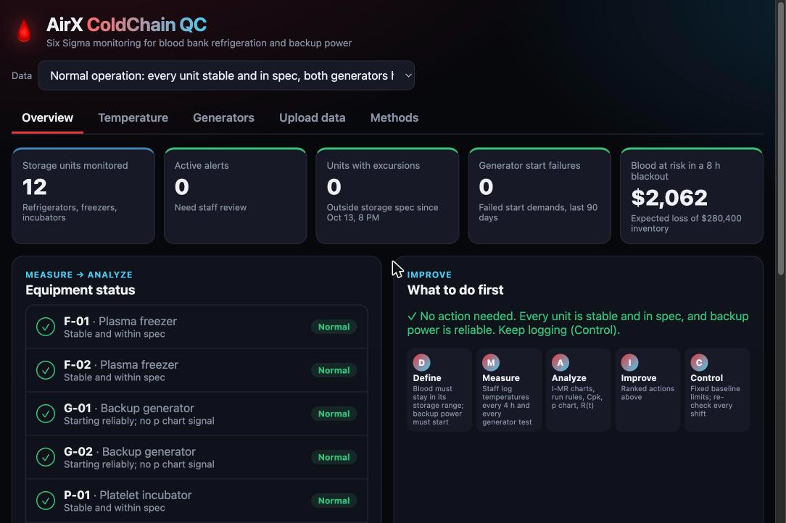
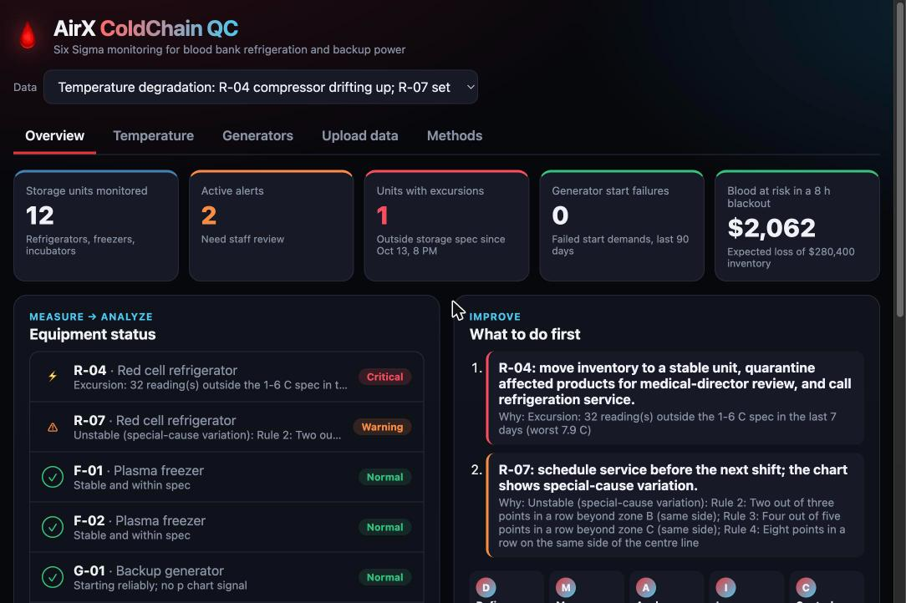
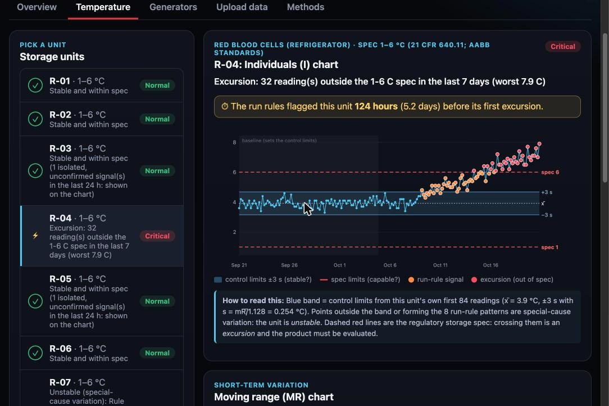
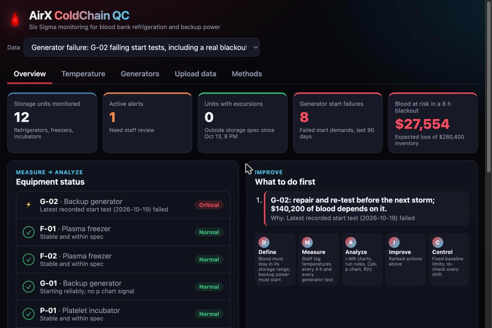
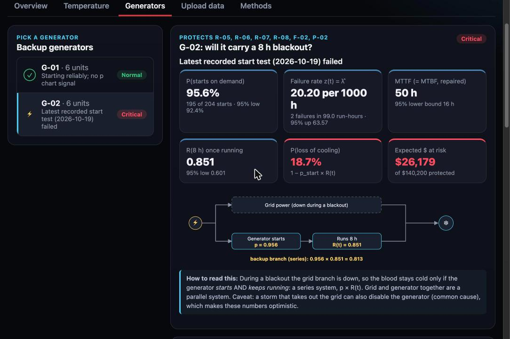
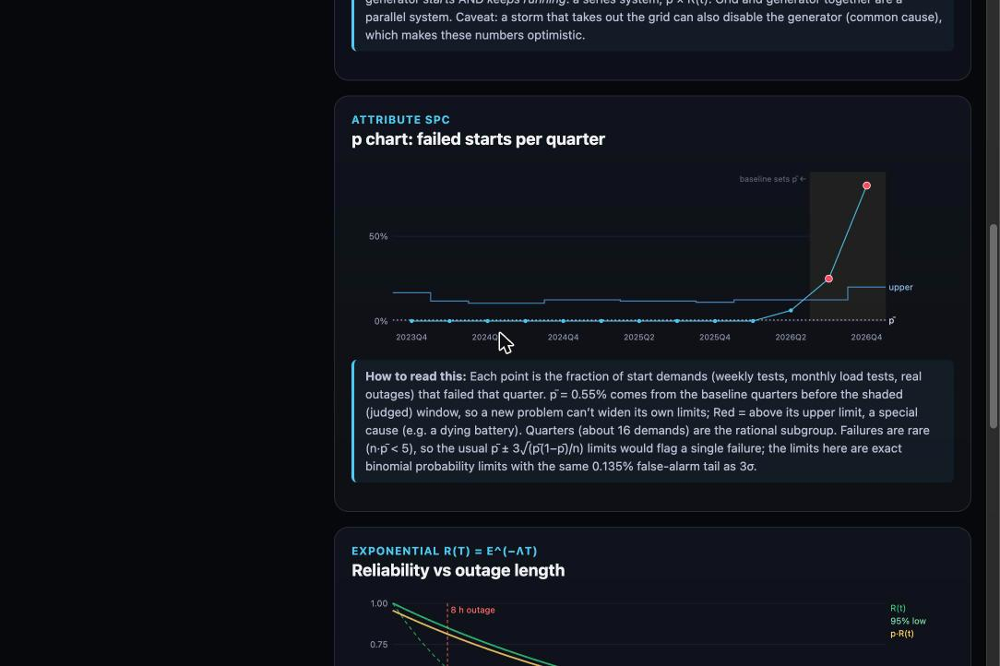

# Demonstration: AirX ColdChain QC on the three test datasets

A guided tour you can follow yourself. Every number below is what the tool prints for the bundled
datasets (seed 5300). If you get a different number, something is wrong. Dataset details are in the
[codebook](../data/README.md).

**Set up:** `./start.sh` from the repo root (it starts both pieces and opens the browser). Or, in two terminals:

```bash
app/api/testme.sh     # runs the 56 tests, then the API on http://localhost:8000
app/web/testme.sh     # the dashboard on http://localhost:5173
```

Pick a scenario in the **Data** menu at the top of the dashboard. Or skip the dashboard and call the
API: `curl http://localhost:8000/analyze/<scenario>`, or use http://localhost:8000/docs.

---

## 1. `normal_operation`: a healthy blood bank



| What you see | Value | How to read it |
|---|---|---|
| Active alerts | **0** | No unit has a confirmed special-cause signal; no excursions |
| Equipment status | 14 × **Normal** | Every unit is stable and in spec; both generators start reliably |
| Cpk (Temperature page) | **1.50 – 2.89** across the 12 units | Every unit comfortably fits its storage spec (>1.33 = good) |
| Blood at risk in an 8 h blackout | **$2,062** | Generators start ~99% of the time, so the expected loss is small but not zero |

**Point to make:** a few units show "isolated, unconfirmed signals". With 8 run rules, some patterns
happen by chance. The tool shows them on the chart but changes a status only on a *confirmed* signal
(≥3 signalling readings in 24 h), which cuts the weekly false-alarm rate on a healthy fridge from ~48%
to ~1%. Two units (R-04, F-01) show a "caution" on capability because their own baseline had a
chance cluster of signals. That's the honest false-alarm rate, stated rather than hidden.

```bash
curl -s localhost:8000/analyze/normal_operation | python3 -c "import sys,json; print(json.load(sys.stdin)['overview'])"
```

---

## 2. `temperature_degradation`: catching a failing compressor early



| What you see | Value | How to read it |
|---|---|---|
| Active alerts | **2** | R-04 Critical, R-07 Warning |
| Units with excursions | **1** | R-04 has 32 readings above 6 °C in the last 7 days (worst 7.9 °C) |
| First action | "R-04: move inventory to a stable unit, quarantine…" | Critical comes before Warning |

Open **Temperature → R-04**:



| Number | Value | Where it comes from |
|---|---|---|
| Baseline | first 84 readings (14 days) | phase I: the grey region |
| x̄ | 3.92 °C | mean of the baseline |
| mR̄ | 0.287 °C | average moving range |
| σ_short = mR̄ / 1.128 | 0.254 °C | short-term sigma |
| Control limits x̄ ± 3σ_short | **3.16 – 4.68 °C** | the blue band (= x̄ ± 2.66 mR̄) |
| MR upper limit D4·mR̄ | 0.937 °C | 3.267 × 0.287 |
| First confirmed signal | **Oct 9, 4 AM** (rules 1 and 3) | orange points leave the band |
| First excursion | **Oct 14, 8 AM** (6.1 °C) | first red point above the dashed 6 °C spec line |
| **Early warning** | **124 hours (5.2 days)** | time to move 120 units of red cells before they were compromised |
| Ppk, last 7 days | −0.27 | negative: the recent mean is outside the spec |

**Point to make:** R-04's baseline Cpk is 2.73, so the fridge *was* capable. That's why the course
says to check **stability (control chart) before capability**: a capable unit can still be failing.
Rule 5 (six rising in a row) is the classic compressor signature. Here rules 1 and 3 fired first
because the drift is steady relative to the noise.

Open **R-07**: control limits 3.40–5.05 °C; on Oct 15 the set point jumps 0.6 °C. Rules 2, 3 and 4 fire
within 12 hours, so **Warning**, yet every reading is still inside 1–6 °C. That's **unstable but still
in spec**: service it before it becomes an excursion.

---

## 3. `generator_failure`: will the blood survive the next blackout?



| What you see | Value | How to read it |
|---|---|---|
| Generator start failures (90 days) | **8** | G-02's failed weekly tests, load tests and the Oct 6 blackout |
| Blood at risk in an 8 h blackout | **$27,554** | $26,179 from G-02 + $1,375 from G-01 |
| First action | "G-02: repair and re-test before the next storm; $140,200 of blood depends on it." | |

Open **Generators → G-02**:



| Number | Value | Formula |
|---|---|---|
| P(starts on demand) | **95.6%** (195 of 204), 95% lower bound 92.4% | starts / demands; exact binomial bound |
| Failure rate λ̂ = z(t) | **0.0202 per hour** (2 failures in 99.0 run-hours) | r / T |
| λ upper (95%) | 0.0636 per hour | χ²(0.95, 2(r+1)) / 2T |
| MTTF (= MTBF for a repaired unit) | **50 h** (95% lower bound 16 h) | 1 / λ̂ |
| R(8 h) once running | **0.851** (95% low 0.601) | e^(−λ̂·8) |
| Backup branch | 0.956 × 0.851 = **0.813** | series: p_start × R(t) |
| P(loss of cooling) | **18.7%** | 1 − 0.813 |
| Expected $ at risk | **$26,179** of $140,200 | inventory × P(loss) |



**p chart** (one point per quarter, ~16 demands): p̄ = **0.55%** from the 11 baseline quarters. The
shaded window is judged against those limits: **2026 Q3: 4 of 16 failed** (upper limit 2 of 16) and
**2026 Q4: 4 of 5 failed** (upper limit 1 of 5) are both signals, a special cause (the
starter/battery). Because failures are rare (n·p̄ < 5), the tool uses exact binomial probability limits
instead of p̄ ± 3√(p̄(1−p̄)/n). With the usual formula a single failed start would breach the limit,
a false alarm.

**Compare G-01:** 202 of 204 starts, no run failures in 105 run-hours, so R(8 h) = 1.00 as a point
estimate. But the 95% lower bound is only **0.796**, because 105 hours without a failure is little
evidence. The tool says so instead of promising perfection.

---

## 4. Upload your own logs

**Upload data** tab → choose your three CSVs → **Analyze**. The same report appears, and the upload is
recorded in this browser's history (file names, time, analyzed?, alerts raised). A file with missing
columns gets a readable error ("temperature_log.csv is missing column(s): temp_c") instead of a crash.
Sample files can be downloaded from the same page.

## 5. Drive the API directly (no dashboard)

| Call | Try |
|---|---|
| Full report | `GET /analyze/generator_failure?outage_hours=24` (a 24-hour storm) |
| I-MR limits for any numbers | `POST /spc/imr` with `{"values": [4.1, 3.9, 4.0, 4.2, 4.4], "baseline_n": 5}` |
| Capability | `POST /capability` with `{"values": [...], "lower": 1, "upper": 6}` |
| One generator | `POST /reliability/generator` with `{"starts": 195, "demands": 204, "run_failures": 2, "run_hours": 99.0}` |

Every endpoint is documented and runnable at http://localhost:8000/docs.
