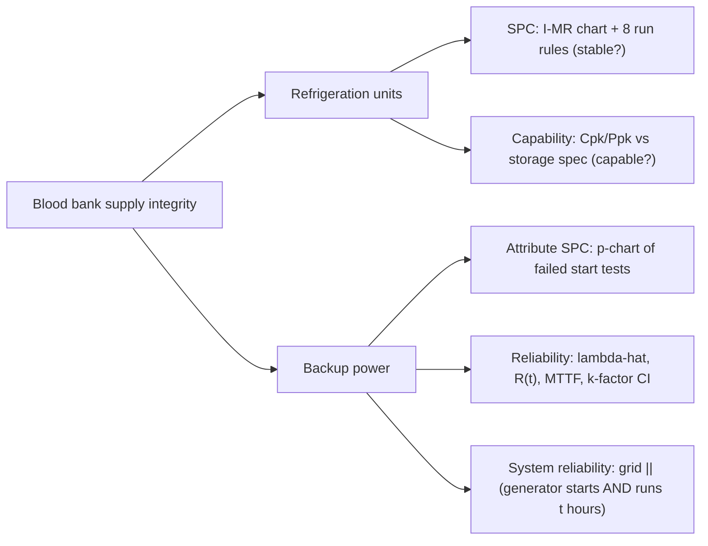
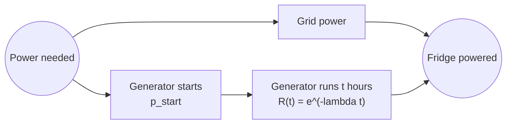

# Six Sigma methods used in this tool

The statistical reference for **AirX ColdChain QC**, our blood bank tool for the SYSEN 5300 Six Sigma Hackathon
(DL track, prompt "Health Care Systems: Blood Banks"). Read it before you write or change any statistic.

The rule for this file: **use the course's names, symbols and formulas** (Dr. Timothy Fraser,
[SYSEN 5300 textbook](https://timothyfraser.com/sigma/); code at
[timothyfraser/sysen](https://github.com/timothyfraser/sysen)). Where we go beyond the course, we say so
in the "Course status" line.

---

## 0. The DMAIC frame for the whole tool

| DMAIC phase | What it means for a blood bank | Where it lives in the tool |
|---|---|---|
| **Define** | CTQ (critical to quality) = blood stays inside its storage temperature range, and backup power starts when the grid fails. Cost of poor quality = discarded units (about $200–$300 per red cell unit; see §8). | README "Problem", Overview page |
| **Measure** | Staff log fridge temperatures every 4 hours and record each generator test. That's the "proxy variables field workers log" that Devpost asks for. | `data/` CSV formats, Upload page |
| **Analyze** | I-MR control charts, the 8 run rules, capability indices, generator start p-chart, exponential reliability. | `app/api/bloodbank_qc/` |
| **Improve** | Ranked actions: service unit R-04, move inventory, repair generator G-02 before the next storm. | Overview "Actions" list |
| **Control** | Keep logging; control limits from a stable baseline; re-run after maintenance. | Temperature page, docs/USER_GUIDE.md |

The two failure modes in the prompt map onto the course's two halves:

---

## 1. Refrigeration units: Individuals and Moving Range (I-MR) chart

**Why I-MR:** each manual log is one reading per unit per time point, so the subgroup size n = 1. The
course's decision tree (Lesson 5 slides) sends n = 1 continuous data to the individuals chart.

**Course status:** taught (Lesson 5 slides, `slides_lesson_5_variable_charts.R`). Fraser has no helper
function for the I chart; the slides build it by hand.

| Quantity | Course formula | Notes |
|---|---|---|
| Moving range | mR_t = \|x_t − x_(t−1)\| | first point has no mR |
| Centre line | x̄ (mean of the **baseline** readings) | |
| σ_short | mR̄ / d2, d2 = **1.128** (n = 2) | "short-term" sigma, mostly common-cause variation |
| σ_total | sd(x) over all baseline readings | used only for Ppk |
| I chart limits | x̄ ± 3·mR̄/1.128 = x̄ ± **2.66**·mR̄ | the course says "upper/lower control limits"; call them that in the UI |
| MR chart limits | lower 0, upper **3.267**·mR̄ (D4 for n = 2) | **see the warning below** |
| Zones for run rules | C = within 1σ_short, B = 1–2σ_short, A = 2–3σ_short | |

> **Deliberate divergence:** Fraser's helper `limits_mr()` uses mR̄ + 3·(mR̄/d2) ≈ 3.66·mR̄, but his
> slides and the 9/24 lecture use D4·mR̄ = 3.267·mR̄. We follow the slides and textbook and say so in the
> README. Constants are **hard-coded** (1.128, 2.66, 3.267), not simulated with `dn()`, which is random
> (it gives d2 = 1.116 at n = 2).

**Baseline (phase I vs phase II):** limits come from a stable baseline window (default: the unit's first
14 days of readings), then new readings are judged against those fixed limits. Limits computed on the
whole series, including the excursion, would hide the very failure we're trying to catch.

**Known-answer test** (`daily_production.csv` from the course repo, 25 days):
x̄ = 2860.28, mR̄ = 279.0417, σ_short = 247.377, I limits [2118.03, 3602.53] (slide 33: 2118 / 3603),
MR upper = 911.91, no signals.

**Textbook:** [Statistical Process Control in Python](https://timothyfraser.com/sigma/chapters/statistical-process-control-in-python.html)

---

## 2. The 8 run rules ("8 visual tests for special variation")

Verbatim from Lesson 5, slide 60. Zones are in units of σ_short around the centre line.

| # | Rule | What it means at a blood bank | Severity in our UI |
|---|---|---|---|
| 1 | One point beyond zone A (outside the control limits) | sudden jump: door left open, power blip, sensor fault | Warning |
| 2 | Two out of three points in a row beyond zone B (same side) | unit struggling to hold set point | Warning |
| 3 | Four out of five points in a row beyond zone C (same side) | sustained shift | Warning |
| 4 | Eight points in a row on the same side of the centre line | set point drifted or thermostat recalibrated | Warning |
| 5 | Six points in a row steadily increasing or decreasing | **compressor degrading: the classic pre-failure signal** | Warning (escalates) |
| 6 | Fifteen points in a row in zone C | suspiciously flat: logger copying the last value, or the sensor is stuck | Review |
| 7 | Eight points in a row on both sides, none in zone C | mixing two units or two thermometers | Review |
| 8 | Fourteen points in a row alternating up and down | over-correcting thermostat, or two staff reading differently | Review |

Fraser's framing: tests 1–2 are early, quickly fixable warnings; tests 7–8 suggest a systemic problem.
Any of these is **special cause** variation. Never call a pattern "common cause".

**Course status:** taught (9/22 lecture, Lesson 5 slide 60). No run-rule code exists upstream, so ours is
original and needs a planted-signal test for every rule.

### 2b. Confirmed-signal policy: managing the false-alarm rate

Running all the run rules on every reading is noisy. Each rule adds its own false-alarm chance (rule 1
alone is about 0.27% per point; rule 4 alone is about 0.8%). We simulated healthy RBC fridges
(`N(4, 0.3)`, rounded to 0.1 C, 14-day baseline, readings every 4 h):

| Alert policy | Healthy unit shows a warning (per check) | 2-sigma shift caught within 24 h | Lead time before a drifting unit leaves spec (median) |
|---|---|---|---|
| Any rule 1-5 hit in the last 7 days | **48%** | ~100% | 120 h |
| Any rule 1-5 hit in the last 24 h | 10.6% | — | 120 h |
| **≥ 3 readings with a rule 1-5 signal in the last 24 h (our policy)** | **1.2%** | **97%** | **108 h** |

So the tool **changes a unit's status only on a confirmed signal**: at least 3 signalling readings in the
last 24 hours (both are parameters: `confirm_count`, `confirm_hours`). Every individual signal still shows
on the chart and in the API's `hits` list. This is the course's average-run-length trade-off (sensitivity
vs. false alarms) made explicit. An excursion outside the **spec** limits is never delayed; it makes the
unit Critical immediately.

The same policy decides whether a unit's 14-day **baseline** is stable. With ~84 baseline readings,
about 1 healthy unit in 6 still shows a confirmed false alarm. For those units the tool shows Cp/Cpk
with a caution note rather than hiding them.

---

## 3. Control limits vs specification limits (stable vs capable)

The paired terms students most often flip. The UI must label them distinctly.

| | Control limits | Specification limits |
|---|---|---|
| Comes from | the process itself (baseline data) | the regulator and the product (see table below) |
| Answers | **Is it stable?** Consistent and predictable | **Is it capable?** Meets required specs |
| On the chart | steelblue shaded band, "±3 s" | **dashed** red lines (course convention) |
| A breach means | early warning: investigate | **excursion: product may be compromised, quarantine and evaluate** |

**Storage specification limits** (E_lower / E_upper in course notation). These are **not from the
course**; cite them in the README and confirm wording before submission:

| Product | E_lower | E_upper | Source to cite |
|---|---|---|---|
| Red blood cells (RBC) | 1 °C | 6 °C | 21 CFR 640.11; AABB Standards |
| Plasma (frozen) | — | −18 °C (one-sided) | 21 CFR 640.34; AABB |
| Platelets | 20 °C | 24 °C | 21 CFR 640.25; AABB |

---

## 4. Capability and performance indices

Only meaningful **after** the I-MR chart says the baseline is stable. The tool prints "capability not
assessed: process unstable" otherwise.

| Index | Course name | Formula | Sigma |
|---|---|---|---|
| Cp | capability index | \|E_upper − E_lower\| / (6σ_short) | short |
| Cpk | capability index (centred) | min(\|μ − E_lower\|, \|E_upper − μ\|) / (3σ_short) | short |
| Pp | process performance index | \|E_upper − E_lower\| / (6σ_total) | total |
| Ppk | process performance index (centred) | min(...) / (3σ_total) | total |

- One-sided specs (plasma ≤ −18 °C): only Cpk/Ppk, using the one limit (`cpk(mu, sigma_s, upper=-18)`).
- Threshold 1.0 (course); we also show 1.33 as a "good" reference line.
- σ_total > σ_short means drift over time (the unit isn't holding steady).
- **Confidence interval** (course theoretical form, 06 recitation):
  v_short = k(n_w − 1) for C indices; for I-MR we use v = (number of baseline readings − 1) and say so.
  Centred: SE = est·√(1/(2v)). k-index: SE = est·√(1/(2v) + 1/(9n·est²)). CI = est ± 1.96·SE.
  An interval that straddles 1.0 means "can't say yet; keep logging".

**Known answers:** cp(2, 100, 80) = 1.6667; cpk(90, 2, 80, 100) = 1.6667; pp(2.5, 100, 80) = 1.3333;
onsen.csv Cp = 0.67131, 95% CI [0.5958, 0.7468].

**Textbook:** [Indices and Confidence Intervals for SPC](https://timothyfraser.com/sigma/chapters/indices-and-confidence-intervals-for-statistical-process-control-in-python.html)

---

## 5. Generators: start tests as an attribute (p) chart

Every weekly/monthly test (and every real outage) is a **demand**: did the generator start and carry
the load? Failures per quarter are binomial counts → **p-chart** (quarters, about 15 demands each, are the rational subgroup: with ~5 demands a month and p̄ ≈ 1%, a single failure would breach a monthly limit).

| Quantity | Course formula |
|---|---|
| p_i | failed starts / demands in quarter i |
| p̄ | Σ failures / Σ demands over the **baseline** months (everything before the last 90 days, if there are at least 4 such quarters) |
| limits | p̄ ± 3·√(p̄(1 − p̄)/n_i), per quarter, clipped to [0, 1], when n·p̄ ≥ 5; otherwise **exact binomial probability limits** with the same 0.135% one-sided tail as 3σ |

**Course status:** taught (9/22 lecture, `ggp()`). Note the glossary wrongly says p-charts aren't covered;
the slides and code teach them. Don't copy `00_p_charts.R:57`, which divides by Σn.

**Small-n fix:** a generator fails to start well under 1% of the time, so even a quarter (≈16 demands)
has n·p̄ far below 5. The normal approximation behind p̄ ± 3σ then breaks down: a **single** failure
lands above the upper limit, a false alarm on a healthy generator. Following the course's rule (change
the chart when the binomial assumptions behind it fail), the tool switches automatically to **exact
binomial probability limits**: the upper limit is the largest failure count with P(X > k) ≤ 0.135%, the
same false-alarm tail as a 3-sigma limit. One failure in 16 is then ordinary (it happens ~8% of the time);
four failures in 16 is a signal. The tool also reports the plain start probability with an exact
(Clopper-Pearson) lower bound.

**Known answer:** `ggp` docstring inventory data: p̄ = 0.067929, upper limit at n = 100 is 0.1434.

---

## 6. Generators: exponential reliability

**Data:** cumulative engine run-hours from each test (hour meter) and whether it failed while running.

| Symbol | Course name | Formula (exponential) |
|---|---|---|
| F(t) | failure function (CDF) | 1 − e^(−λt) |
| R(t) | reliability | e^(−λt) |
| f(t) | change in failure function (PDF) | λe^(−λt) |
| z(t) | failure rate (hazard rate) | f/R = λ, constant |
| H(t) | accumulative hazard | λt |
| MTTF (m) | mean time to fail | 1/λ |

- **Estimate:** λ̂ = r / T (r failures in T total run-hours). With time censoring:
  λ̂ = r / (Σt_i + (n − r)t_z).
- **Confidence interval** (course k-factor, `functions_k.R`): upper bound
  λ_upper = qchisq(p, 2(r + 1)) / (2T). With **zero failures**: λ_upper = −ln(1 − p) / T.
  That matters, because a healthy generator often has no failures yet.
- **Output for a blackout of length t hours:** R(t | it started) = e^(−λ̂t), plus its lower bound.
- **Naming:** the course uses **MTTF throughout** and its glossary says MTBF "does not appear". Jake's
  proposal says MTBF. Generators are repaired and returned to service, so MTBF is the industry word. Under
  the exponential (memoryless) model with as-good-as-new repair, MTBF = MTTF = 1/λ. **The UI says
  "MTTF (= MTBF for a repaired generator)"**, and the README explains it as an extension.
- **Assumption check:** exponential means constant hazard (the flat bottom of the bathtub). Ageing units
  wear out (Weibull m > 1). The README states the assumption; a Weibull check is a stretch goal.

**Known answers:** r(1000, 1/2000) = 0.60653; f(100, 0.01) = 0.63212; z(t) = λ; rotary pump
λ = 4.28e-4/h → R(730) = 0.7317, MTTF = 2336.4 h.

**Textbook:** [Useful Life Distributions: Exponential](https://timothyfraser.com/sigma/chapters/useful-life-distributions-exponential-in-python.html),
[Statistical Techniques for Exponential Distributions](https://timothyfraser.com/sigma/chapters/statistical-techniques-for-exponential-distributions-in-python.html)

---

## 7. System reliability: does the fridge keep power during a blackout?

Block diagram (series inside parallel, solved inside out, as the course teaches):

- Backup branch (series): R_backup(t) = p_start × e^(−λt)
- During an outage the grid is down, so supply depends only on the backup branch:
  **P(loss of cooling during a t-hour outage) = 1 − R_backup(t)**
- Over a year (parallel, grid ∥ backup): R_system = 1 − (1 − R_grid)(1 − R_backup)
- **Dollars at risk** = units in storage × value per unit × P(loss). That turns the reliability number
  into the prompt's "thousands of dollars".
- **Common-cause caveat** (course P24): the storm that takes out the grid can also flood the generator,
  which breaks the independence that the parallel formula assumes. Stated in the UI.

**Known answers:** two parallel parts at R = 0.9 → 0.99; Challenger 1 − 0.99⁸ = 0.07726.

**Textbook:** [System Reliability in Python](https://timothyfraser.com/sigma/chapters/system-reliability-in-python.html)

---

## 8. Facts from outside the course (cite in README)

- Storage temperature specs (§3): FDA 21 CFR 640; AABB Standards for Blood Banks and Transfusion Services.
- Manual temperature recording every 4 hours when there's no continuous recorder: AABB practice. Confirm
  the citation before quoting it.
- Emergency generator testing (monthly load test): NFPA 110 / NFPA 99 for healthcare facilities. Confirm.
- Red cell unit cost of roughly $200–$300: use a cited figure (e.g. the NBCUS survey) or make it a user
  input with a default.

## 9. Pitfalls (from Carter's course feedback; the UI and docs must avoid these)

- Don't flip **R vs F**, **control vs spec limits**, **σ_short vs σ_total**, **Cp vs Pp**. Label every number.
- Never say "capable" about a control chart. Control charts show stable; specs show capable.
- f(t) is the density; z(t) is the rate. Always name the symbol; "failure rate" alone is ambiguous.
- Answer the quantity asked: P(survive) vs P(fail), counts vs probabilities, and always a conclusion sentence.
- Report indices with confidence intervals. Unlabelled plots lose points.
- Manual readings 4 hours apart can be autocorrelated, which inflates false alarms. Stated as an assumption.
