# 📖 AirX ColdChain QC: illustrated walkthrough

A page-by-page tour of the dashboard, with screenshots of the current version. It covers how to
**switch datasets**, **download them**, **read the codebook in the Explorer**, and what every page
shows and how to read it.

> **Run it first:** `./start.sh` from the repo root (install steps are in the [README](../README.md#-run-it-on-your-computer)).
> The dashboard opens at **http://localhost:5173**; the API is at **http://localhost:8000/docs**.
> No install? The same app is live at
> **[connect.systems-apps.com/content/2f99849a-…](https://connect.systems-apps.com/content/2f99849a-2483-4b3e-91c5-1bf7caf8e417/)**
> (API docs at [`/docs`](https://connect.systems-apps.com/content/2f99849a-2483-4b3e-91c5-1bf7caf8e417/docs)).

**Contents**

1. [The screen at a glance](#1-the-screen-at-a-glance)
2. [Switching datasets](#2-switching-datasets)
3. [Downloading a dataset](#3-downloading-a-dataset)
4. [The Explorer: codebook and raw data](#4-the-explorer-codebook-and-raw-data)
5. [Overview page](#5-overview-page)
6. [Temperature page](#6-temperature-page)
7. [Generators page](#7-generators-page)
8. [Upload data page](#8-upload-data-page)
9. [Methods page](#9-methods-page)
10. [About AirX page](#10-about-airx-page)
11. [The REST API (/docs)](#11-the-rest-api-docs)
12. [Quick reference: where to find what](#12-quick-reference-where-to-find-what)

---

## 1. The screen at a glance

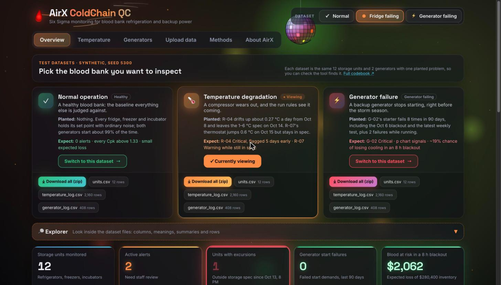

Every page shares the same frame:

| Area | What it is |
|---|---|
| **Logo and title** (top left) | AirX ColdChain QC. The wind blowing behind the 🩸 is the "Air" in AirX. |
| **Dataset switcher** (top right) | One button per test dataset. The lit-up button is the one you're viewing. See [section 2](#2-switching-datasets). |
| **Tabs** | **Overview · Temperature · Generators · Upload data · Methods · About AirX**. The highlighted tab is the current page. |
| **Colour theme** | The whole site is tinted by the dataset you're viewing: **green** = Normal operation, **orange** = Temperature degradation (fridge failing), **red** = Generator failure. |
| **Disco ball and moving lights** | Decoration only. They carry no data. |

The Overview opens on the **Temperature degradation** dataset, so there's something to look at straight away.

---

## 2. Switching datasets

There are **three test datasets**. Each is the same blood bank (12 storage units, 2 backup generators)
with one planted problem, so you can check that the tool finds it.

| Dataset | Planted problem | What the tool should show |
|---|---|---|
| **Normal** (Normal operation) | nothing | 0 alerts, everything green |
| **Fridge failing** (Temperature degradation) | R-04's compressor drifts warmer; R-07's set point jumps | R-04 **Critical**, flagged 5 days early; R-07 **Warning** |
| **Generator failing** (Generator failure) | G-02 stops starting reliably | G-02 **Critical**, ~19% chance of losing cooling in an 8 h blackout |

**Two ways to switch:**

**A. The Dataset switcher (top right, on every page).** Click a button. The lit button is the current dataset.

**B. The dataset cards (Overview page).** Click **Switch to this dataset →** on a card. The card you're
viewing shows **✓ Currently viewing** and a **● Viewing** tag.

When you switch, the old dashboard **falls away and the new one drops into place**. This is just
animation; the numbers are recalculated by the API for the new dataset:

After the switch, the switcher, the card and the colour theme all show the new dataset (here,
**Generator failing**, red):

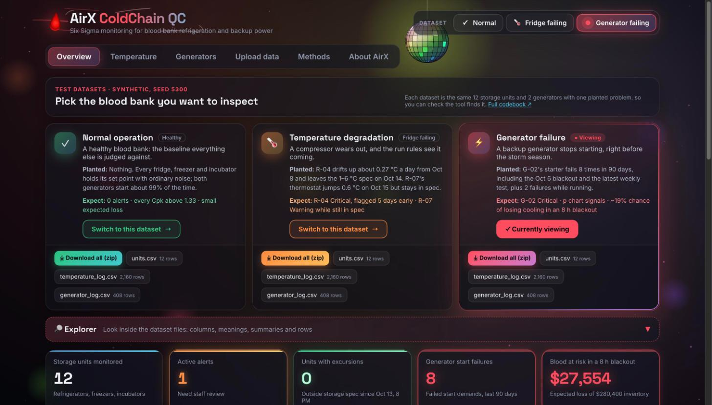

> **Tip:** you can click quickly. While a switch is animating, your next choice shows **⏳ Up next** and
> runs as soon as the current one finishes; only the last click counts.

---

## 3. Downloading a dataset

Each dataset card on the **Overview** has a download bar:

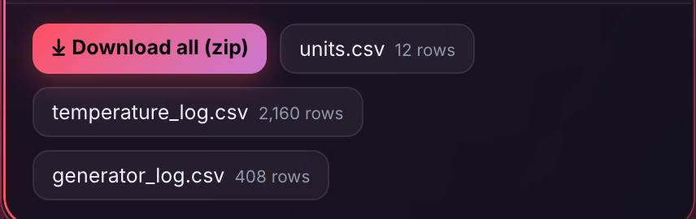

| Button | Downloads |
|---|---|
| **⤓ Download all (zip)** | `airx_<dataset>.zip`: all three CSV files plus `CODEBOOK.md` |
| **units.csv** | the inventory list (12 rows) |
| **temperature_log.csv** | every thermometer reading (2,160 rows: 12 units × 6 a day × 30 days) |
| **generator_log.csv** | every generator start demand (408 rows over 3 years) |

The same files are in the repo under [`data/`](../data/), with the full codebook in
[`data/README.md`](../data/README.md).

---

## 4. The Explorer: codebook and raw data

Under the dataset cards is the **🔎 Explorer** tab. Click it to open (and again to close). It lets you
look inside any file without downloading it.

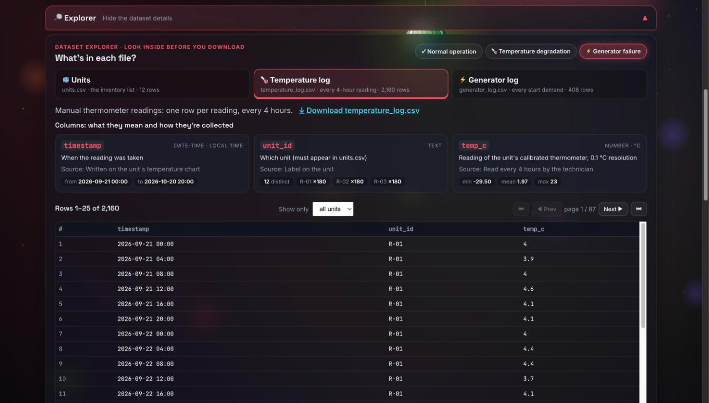

**How to use it:**

1. **Pick a dataset** with the chips at the top right of the Explorer (*Normal operation · Temperature
   degradation · Generator failure*). It follows the dataset you're viewing, but you can pick another.
2. **Pick a file** with the three file tabs: **🧊 Units**, **🌡 Temperature log**, **⚡ Generator log**.
   Each tab shows the file name, what one row is, and how many rows it has.
3. **Read the codebook**: one card per column, showing:
   - the **column name** and its **type and units** (e.g. `temp_c`, NUMBER · °C)
   - **what it means**
   - **Source:** how a real blood bank would collect it (e.g. "Read every 4 hours by the technician")
   - a quick **summary**: min / mean / max for numbers, first / last for dates, and the most common
     values for text (e.g. `weekly_exercise ×157`)
4. **Browse the rows** in the table below the cards:
   - **Show only** filters to one unit or generator (e.g. `R-04` or `G-02`)
   - **⏮ ◀ Prev · Next ▶ ⏭** pages through the file 25 rows at a time
   - **⤓ Download \<file\>** (next to the description) downloads just that file

In the generator log, **failed starts (`started = 0`) are red** and **real outages are orange**, so
problems stand out. Here's G-02's last page in the Generator failure dataset, including the failed
start during the **2026-10-06 blackout**:

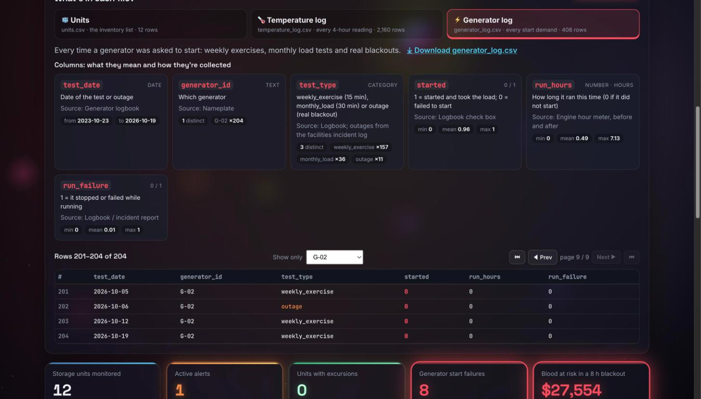

---

## 5. Overview page

The Overview answers **"what needs attention right now?"** Below the dataset cards and Explorer are:

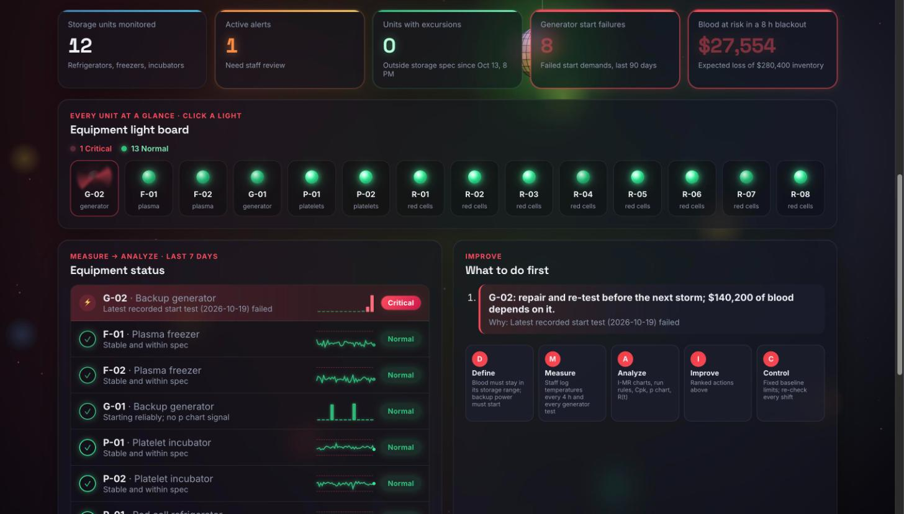

**Stat tiles (top row):**

| Tile | Meaning |
|---|---|
| Storage units monitored | how many fridges, freezers and incubators are in the data |
| Active alerts | units and generators with a Warning or Critical status |
| Units with excursions | units with a reading **outside the storage spec** in the last 7 days |
| Generator start failures | failed start demands in the last 90 days |
| Blood at risk in an 8 h blackout | expected dollars lost = inventory × P(loss of cooling) |

Colours carry meaning: **green glow = good**, **amber pulse = borderline**, **flashing red = bad**.

**Equipment light board:** one light per unit and generator. 🟢 green glows = Normal, 🟠 amber blinks
= Warning, 🔴 red flashes (with a spinning siren) = Critical, 🟣 purple = Review. **Click a light** to
open that unit or generator.

**Equipment status** (left) and **What to do first** (right):

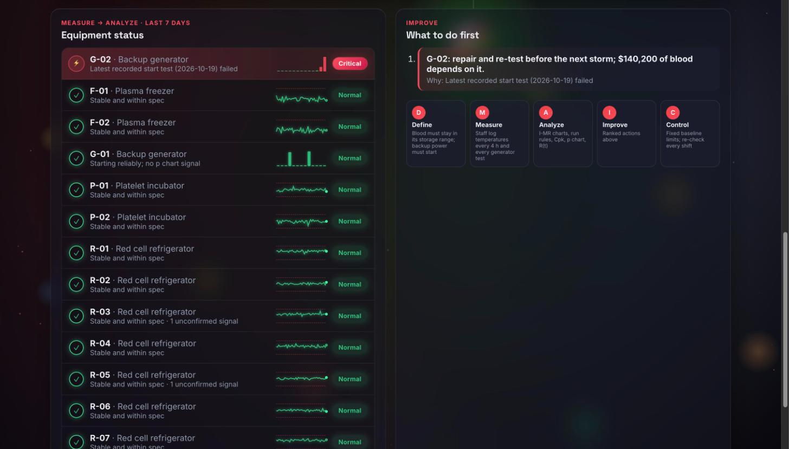

- **Equipment status** lists every item, worst first, with its status, the reason in words (e.g. *"Latest
  recorded start test (2026-10-19) failed"*), and a mini chart: the last 7 days of temperature for a
  fridge, or failed starts per quarter for a generator. Click a row to open it.
- **What to do first** ranks the actions (Critical before Warning, then by dollars involved).
- The **DMAIC strip** shows where each part of the tool fits in Define → Measure → Analyze → Improve → Control.

How the Overview looks on the other two datasets:

| Normal operation (all green) | Temperature degradation (R-04 Critical, R-07 Warning) |
|---|---|
| 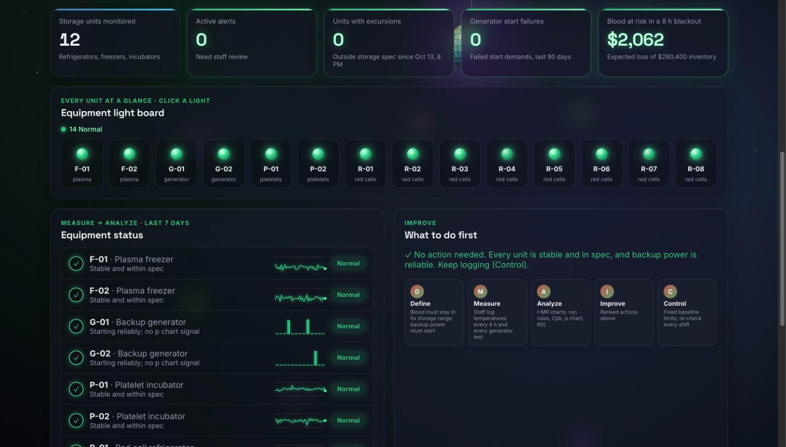 | 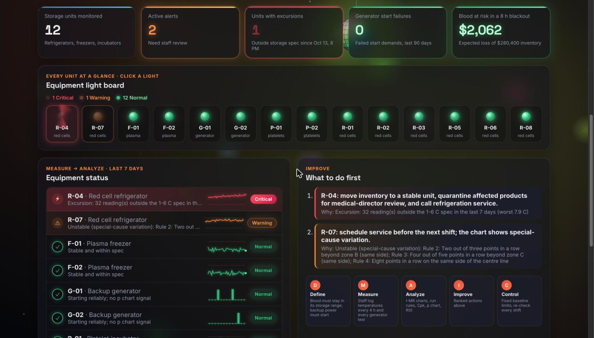 |

---

## 6. Temperature page

One storage unit at a time: **is it stable, and is it capable of holding its storage spec?**
Pick a unit in the **Storage units** list on the left. The page opens on the most urgent unit.

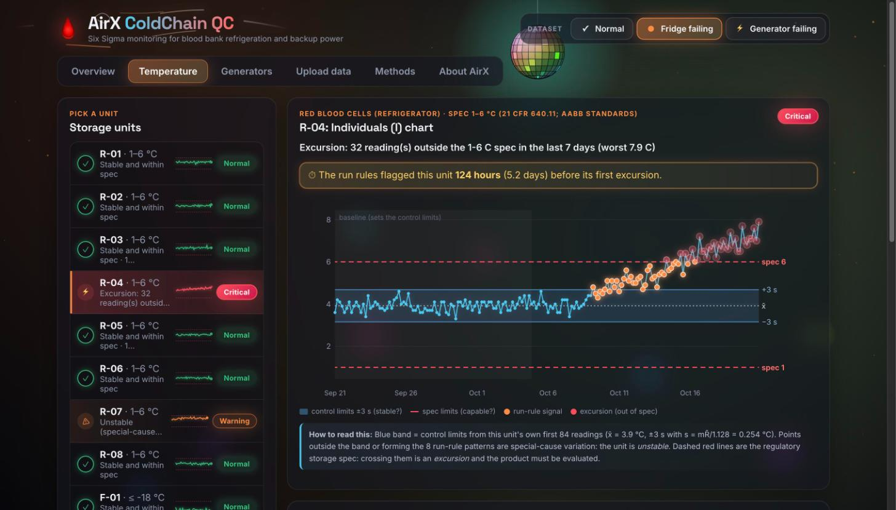

**Individuals (I) chart**, the main chart:

| Element | Meaning |
|---|---|
| **Grey shaded region** | the **baseline**: the unit's first 14 days, which set its control limits |
| **Blue band (±3 s)** | **control limits**: the range the unit normally varies in. Answers *"is it stable?"* |
| **Dotted line x̄** | the baseline average |
| **Dashed red lines (spec 1 / spec 6)** | **specification limits** from regulation (red cells 1–6 °C). Answers *"is the blood safe?"* |
| **Orange points** | **run-rule signals**: special-cause patterns (e.g. a steady rise) |
| **Red points** | **excursions**: readings outside the storage spec |
| **Yellow banner** | how many hours **before** the first excursion the run rules flagged the unit (R-04: **124 h, 5.2 days**) |

Hover over any point to see its time, temperature and which rule fired. Each chart has a
**How to read this** box underneath.

Scroll down for the **moving range chart**, the **run-rule signals** and **capability**:

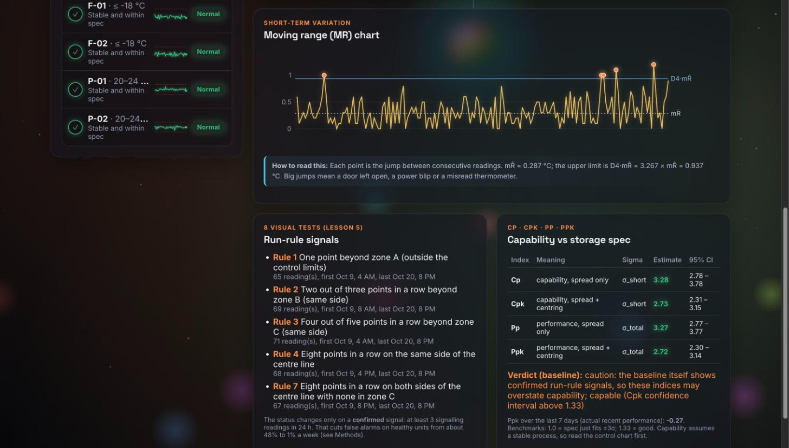

- **Moving range (MR) chart:** the jump between consecutive readings; points above **D4·mR̄** are unusual jumps (door left open, power blip, misread thermometer).
- **Run-rule signals:** which of the course's 8 visual tests fired after the baseline, how many readings, and when. A unit's **status** changes only on a **confirmed** signal (≥3 signalling readings in 24 h), which keeps false alarms on healthy units to about 1%.
- **Capability vs storage spec:** **Cp, Cpk** (σ_short) and **Pp, Ppk** (σ_total) with 95% confidence intervals and a verdict. Green ≥ 1.33 (good), gold 1.0–1.33, red < 1.0. *Capability assumes a stable process, so read the control chart first.*

---

## 7. Generators page

One backup generator at a time: **will it carry the blood through a blackout?**
Pick a generator on the left.

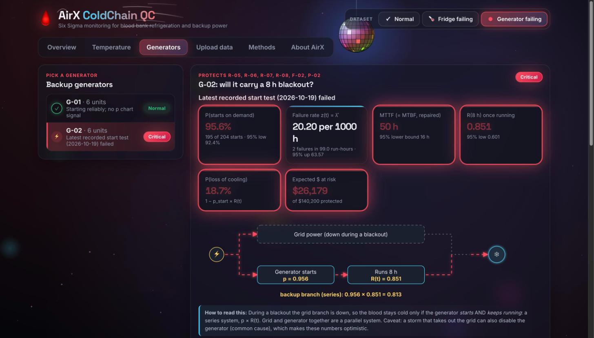

**Reliability tiles:**

| Tile | Meaning |
|---|---|
| P(starts on demand) | share of start attempts that worked, with a 95% lower bound |
| Failure rate z(t) = λ̂ | failures per 1,000 running hours (r / T), with a 95% upper bound |
| MTTF (= MTBF, repaired) | mean time to fail = 1/λ ("no failures yet" if there have been none) |
| R(8 h) once running | chance it keeps running for an 8-hour outage, e^(−λt) |
| P(loss of cooling) | 1 − P(start) × R(8 h): chance the blood warms up in an 8 h blackout |
| Expected $ at risk | inventory this generator protects × P(loss of cooling) |

The **block diagram** shows why: in a blackout the grid is down, so the fridge stays powered only if the
generator **starts** *and* **keeps running** (a series system). The moving dashes show the power path.

Scroll down for the **p chart** and the **reliability curve**:

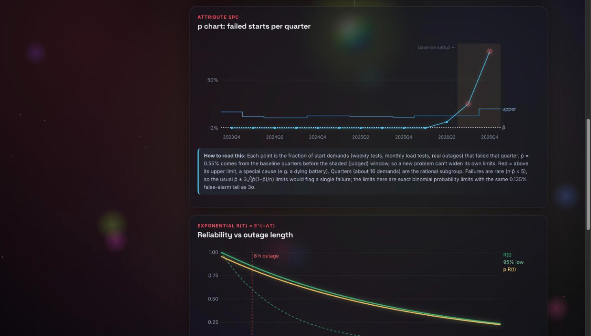

- **p chart: failed starts per quarter.** Each point is the fraction of start demands that failed that
  quarter. The **shaded window** (the last 90 days) is judged against limits set by the earlier
  **baseline** quarters. **Red points** are above their limit, a special cause (here, G-02's starter in
  2026 Q3–Q4).
- **Reliability vs outage length.** R(t) for 0–72 hours (green), its 95% lower bound (dashed), and
  P(start) × R(t) (gold). The red dashed line marks the 8 h planning outage.

At the bottom, **Latest log entries** shows the generator's last 12 tests and outages, with failures in red:

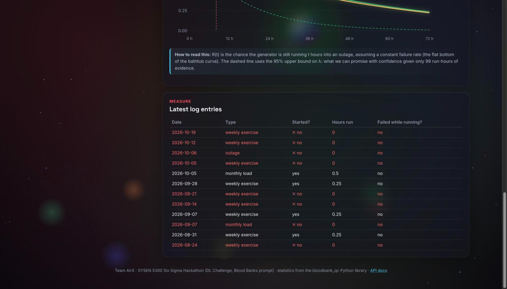

---

## 8. Upload data page

Analyze **your own** logs in the same format as the test datasets.

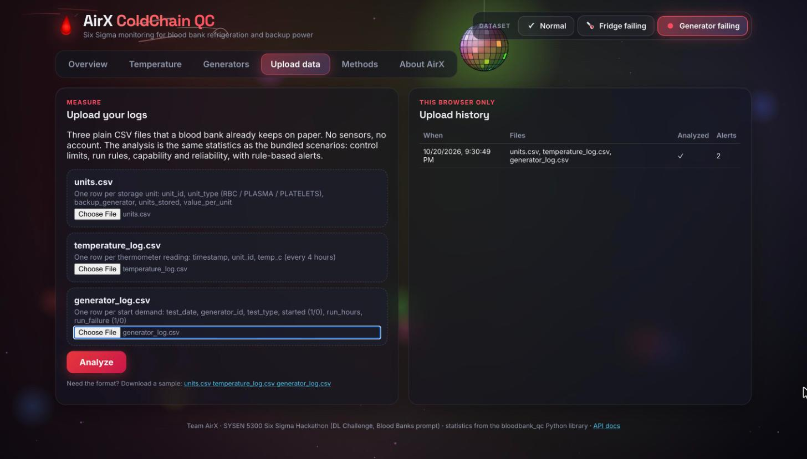

1. Choose the three files: **units.csv**, **temperature_log.csv**, **generator_log.csv**. Each box lists the columns it needs.
2. Click **Analyze**.
3. Need the format? Use **Download a sample** at the bottom, or the Explorer's codebook.

The **Upload history** (right) records each upload in this browser: time, files, whether it was
analyzed, and how many alerts it raised. A file with a missing column gives a readable error (e.g.
*"temperature_log.csv is missing column(s): temp_c"*) instead of crashing.

After a successful upload, a **Your upload** card and switcher button appear, and every page now shows
your data. Switch back to a test dataset any time:

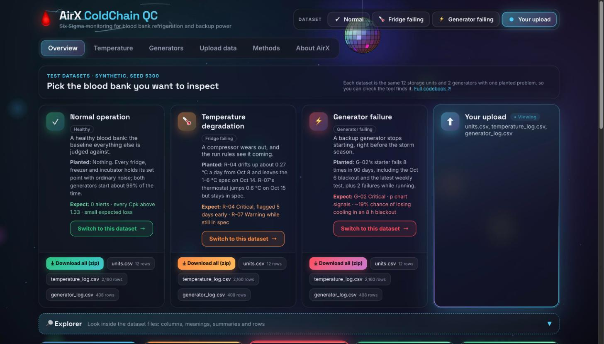

---

## 9. Methods page

Every statistic in plain language, with the formula and the SYSEN 5300 course chapter it comes from.

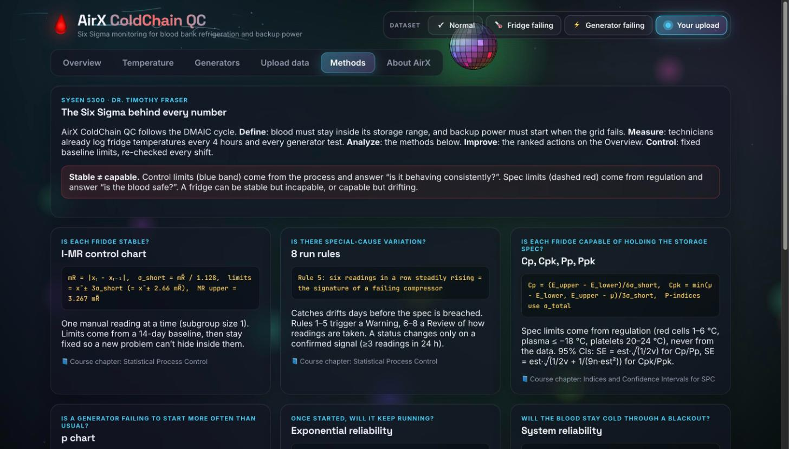

Six cards: **I-MR control chart · 8 run rules · Cp/Cpk/Pp/Ppk · p chart · exponential reliability ·
system reliability**. Below them, **Assumptions we state openly** lists what the numbers assume
(independent readings, a clean baseline, constant failure rate, independent grid and generator).
Full detail: [`docs/SIX_SIGMA_METHODS.md`](SIX_SIGMA_METHODS.md).

---

## 10. About AirX page

Who built the tool, what it's for, a five-step quick start, how it's built, and credits.

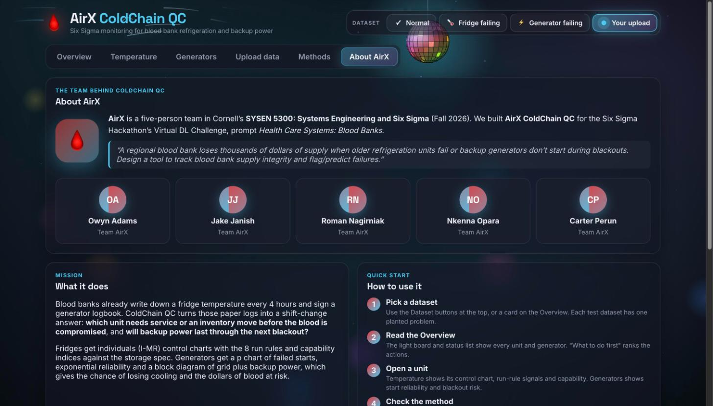

---

## 11. The REST API (/docs)

Every number on the dashboard comes from the API, and you can call it yourself. Open
**http://localhost:8000/docs** while the app is running, click an endpoint, then **Try it out → Execute**.

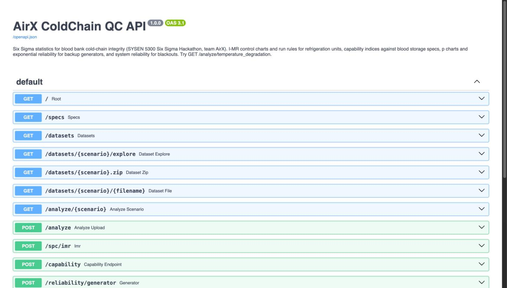

| Endpoint | Use |
|---|---|
| `GET /datasets` | the three test datasets, with descriptions and file sizes |
| `GET /datasets/{id}/explore` | what the Explorer shows: codebook, summaries, rows |
| `GET /datasets/{id}.zip` | download a dataset |
| `GET /analyze/{id}` | the full analysis behind the dashboard (try `?outage_hours=24`) |
| `POST /analyze` | analyze your own three CSV files |
| `POST /spc/imr`, `POST /capability`, `POST /reliability/generator` | one statistic at a time, for checking numbers by hand |

Function-by-function documentation: [`app/api/README.md`](../app/api/README.md).

---

## 12. Quick reference: where to find what

| I want to… | Go to |
|---|---|
| see what needs attention | **Overview** → light board and *What to do first* |
| change dataset | **Dataset** switcher (top right) or *Switch to this dataset →* on a card |
| download the data | **Overview** → dataset card → *Download all (zip)* or a single file |
| see what each column means | **Overview** → **🔎 Explorer** → pick a file → column cards |
| look at the raw rows | **🔎 Explorer** → table (filter with *Show only*, page with ◀ ▶) |
| check one fridge | **Temperature** → pick the unit on the left |
| check a generator / blackout risk | **Generators** → pick the generator on the left |
| use my own data | **Upload data** |
| understand a formula | **Methods** (or the *How to read this* box under any chart) |
| know who built it | **About AirX** |
| check the numbers myself | **http://localhost:8000/docs**, or the tests in [`docs/TESTS.md`](TESTS.md) |
