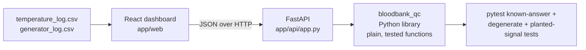

# Plan: AirX ColdChain QC (team AirX, DL track, Blood Banks prompt)

The build plan for every human and agent on the team. **Read [`SPEC.md`](../SPEC.md),
[`CONTRACT.yaml`](../CONTRACT.yaml) and [`docs/SIX_SIGMA_METHODS.md`](SIX_SIGMA_METHODS.md) first.**
This file says *how* and *in what order*; SIX_SIGMA_METHODS says *which statistic and why*.

- **Deadline:** Fri Oct 23, 3 PM ET (1 PM MT). Submit on Devpost (repo link + demo), then paste the
  repo URL and the Devpost link into Canvas.
- **Source of the design:** Jake Janish's "Hackathon Scope Proposal" (React dashboard + Python stats
  library + FastAPI; I-MR charts; R(t) and MTBF; upload history; three datasets).
- **Rubric:** [criteria](https://github.com/timothyfraser/sixsigmahackathon/blob/main/docs/criteria.md):
  working tool 25, valid QC analysis 25, scope 5, user 5, minimal inputs 5, demo 10, docs 10,
  datasets 5, codebook 5, public reproducible repo 5.

---

> **Status 2026-10-21:** built. See [`docs/HANDOFF.md`](HANDOFF.md) for what is done, how to run it,
> and the decisions made while building (they refine this plan: a third input file `units.csv`, a
> confirmed-signal status policy, and a quarterly p chart with exact binomial limits).

## 1. Product in one paragraph

**User:** the blood bank's **storage and quality technician**, the person who already writes down every
fridge temperature each shift and signs off on the monthly generator test.
**Decision:** at each shift change, *which refrigeration unit needs service or an inventory move before
it goes out of spec, and is backup power reliable enough to ride out the next blackout?*
**Inputs:** CSV logs they already keep on paper: a temperature log, a generator test log, and a short
inventory list (`units.csv`). No
sensors or telemetry needed, which is the Devpost "data collection challenge".
**Outputs:** a status for every unit (Normal / Warning / Critical) with the Six Sigma reason (which run
rule, which limit), I-MR charts, capability indices with CIs, a generator p-chart and reliability curve,
the probability of losing cooling in a t-hour blackout, and the dollars of blood at risk.

## 2. Architecture

| Layer | Folder | Rule |
|---|---|---|
| Statistics library | `app/api/bloodbank_qc/` | plain functions, pandas/numpy/scipy only, **never imports FastAPI**; every function has a docstring citing the course chapter |
| REST API | `app/api/app.py` | thin: parse, call the library, return JSON; `/docs` is a demo asset |
| Dashboard | `app/web/` (Vite + React) | **no statistics in UI code**; API base URL in `src/config.js` only |
| Data | `data/` | three scenario folders + `data/README.md` codebook + `data/make_datasets.py` (seeded, reproducible) |
| Tests | `app/api/tests/` | pytest; known answers from the course (see SIX_SIGMA_METHODS) |

Both `app/api` and `app/web` keep the four-script contract (`testme`, `manifestme`, `deployme`, `README.md`).

## 3. Library functions (`bloodbank_qc`)

| Module | Function | Returns | Course concept |
|---|---|---|---|
| `spc.py` | `moving_range(x)` | array of \|x_t − x_(t−1)\| | I-MR |
| | `imr_limits(x_baseline)` | dict: xbar, mrbar, sigma_s, sigma_t, i_upper, i_lower, mr_upper | I-MR (2.66, 3.267) |
| | `run_rules(x, center, sigma_s)` | list of {rule, index, description} for rules 1–8 | 8 visual tests |
| | `p_chart(failures, demands)` | per-period p, pbar, upper, lower | attribute SPC |
| `capability.py` | `cp, cpk, pp, ppk(...)` | float (one-sided aware) | capability vs performance |
| | `index_ci(est, v, n, kind)` | (lower, upper) | theoretical CI |
| `reliability.py` | `F, R, f, z, H, afr(t, lambda_)` | floats/arrays | failure functions |
| | `lambda_hat(failures, total_time, censored...)` | λ̂ | exponential estimate |
| | `lambda_upper(r, T, conf)` | chi-square / zero-failure bound | k-factor |
| | `mttf(lambda_)` | 1/λ | MTTF (= MTBF note) |
| `system.py` | `series(*R)`, `parallel(*R)` | R_system | system reliability |
| | `backup_power(p_start, lambda_, t)` | P(backup carries t hours) | series in parallel |
| | `dollars_at_risk(units, unit_value, p_loss)` | $ | cost of poor quality |
| `specs.py` | `STORAGE_SPECS` | RBC 1–6, plasma ≤ −18, platelets 20–24 °C | spec limits (cited) |
| `analyze.py` | `analyze_unit(df, unit_type)`, `analyze_generators(df)`, `analyze_dataset(temp_df, gen_df)` | full status JSON the API returns | ties it together |

**Status logic (per fridge):** Critical = any reading outside spec in the last 7 days (an excursion).
Warning = ≥3 readings with a rule 1–5 signal in the last 24 h (confirmed signal; see SIX_SIGMA_METHODS
§2b). Review = the same for rules 6–8. Normal = otherwise. Every status carries its reason
text, e.g. "Rule 5: six readings in a row increasing (4.1 → 5.2 °C)".

**Status logic (per generator):** Critical = failed its most recent start test, or a p-chart point above
its upper limit. Warning = R_backup(8 h) below 0.95 (configurable). Normal = otherwise.

## 4. API endpoints

| Method | Path | Body | Returns |
|---|---|---|---|
| GET | `/` | – | health + link to `/docs` |
| GET | `/datasets` | – | the three bundled scenarios |
| GET | `/analyze/{scenario}` | – | full analysis of a bundled scenario |
| POST | `/analyze` | multipart: temperature_log.csv, generator_log.csv | the same JSON for uploaded files |
| POST | `/spc/imr` | {values, baseline_n} | limits + run-rule hits |
| POST | `/capability` | {values, lower, upper} | Cp, Cpk, Pp, Ppk + CIs |
| POST | `/reliability/generator` | {failures, run_hours, p_start, outage_hours} | λ̂, bounds, R(t), MTTF, P(loss) |

## 5. Dashboard pages (from Jake's proposal)

1. **Overview:** tiles (units monitored, active alerts, units with excursions, generator test failures),
   equipment status list (Normal / Warning / Critical with reason), "dollars at risk" tile, ranked actions.
2. **Temperature (process control charts):** unit picker; I chart with steelblue ±3 s band, dashed red
   spec lines, run-rule points marked; MR chart below; capability card (Cp/Cpk/Pp/Ppk ± CI, or
   "not assessed: unstable"); "how to read this" line.
3. **Generators:** start-test p-chart; R(t) curve for 0–72 h with its lower bound; MTTF; P(loss of
   cooling) for a chosen outage length; block diagram.
4. **Upload data:** drag two CSVs, run the analysis, and keep an upload history (filename, time, analyzed,
   alert raised) in the browser's local storage. Uses rule-based statistical alerts, not an LLM (pending
   team confirmation).
5. **Methods:** plain-language Six Sigma explanation of each number, linking SIX_SIGMA_METHODS.

## 6. Test datasets (`data/`)

Each scenario is a folder with `temperature_log.csv` and `generator_log.csv`: 12 storage units
(8 RBC fridges, 2 plasma freezers, 2 platelet incubators), readings every 4 hours for 30 days, and 2
generators with weekly start tests plus monthly load tests over 12 months.

| Scenario | Planted signal | What the tool must show |
|---|---|---|
| `normal_operation/` | none | all Normal, Cpk > 1.33, generators Normal |
| `temperature_degradation/` | R-04 compressor drifts up from day 18 (+0.08 °C/reading), crossing 6 °C around day 26 | Rule 5/2/3 Warning **days before** the Critical excursion: the early-warning story |
| `generator_failure/` | G-02 fails 3 of its last 6 start tests and has 2 run failures | p-chart signal, low R(8 h), Critical, dollars at risk |

`data/make_datasets.py` regenerates all of them from a fixed seed. `data/README.md` is the codebook:
every column with units, and how a real blood bank would collect it.

## 7. Task order (maps to CONTRACT.yaml)

| Order | CONTRACT | Task | Owner |
|---|---|---|---|
| 1 | H-01 | Finish SPEC.md from this plan (Roman started section 1) | Claude (Carter) |
| 2 | H-02 | `data/` generator script, 3 scenarios, codebook | Claude |
| 3 | H-03 | `bloodbank_qc` library + pytest (known answers first) | Claude, then stats review |
| 4 | H-04 | FastAPI wiring + React dashboard | Claude |
| 5 | H-06 | Deploy API + dashboard to Posit Connect | live since 2026-10-22 (one app; URL in README); Action redeploys on push to `main` |
| 6 | H-05 | `demo/README.md` walkthrough of each scenario + screenshots | Claude, a teammate verifies |
| 7 | H-07 | README (tool), app READMEs, function docs | Claude |
| 8 | H-08 | Fresh-clone check, Devpost submission | team |

**Definition of done** for each task is the runnable check in CONTRACT.yaml. Quote its output in the commit.

## 8. Out of scope

Logins, a database, real patient or donor data, LLM-generated analysis, live sensor feeds, multi-site
comparison, forecasting beyond the run rules and reliability curve. Weibull wear-out modelling is a stretch goal.

## 9. Open questions

See [`docs/OPEN_QUESTIONS.md`](OPEN_QUESTIONS.md). Decisions get recorded there with a date.
